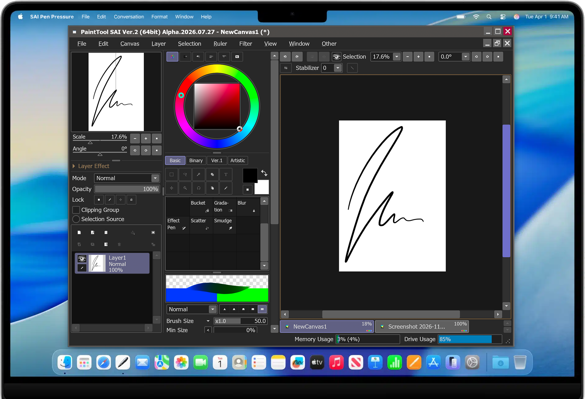
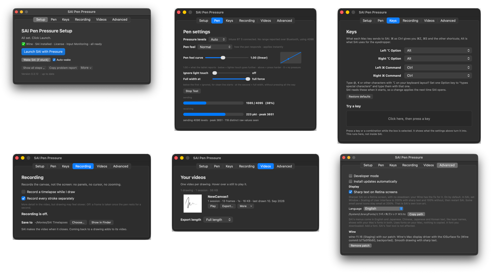
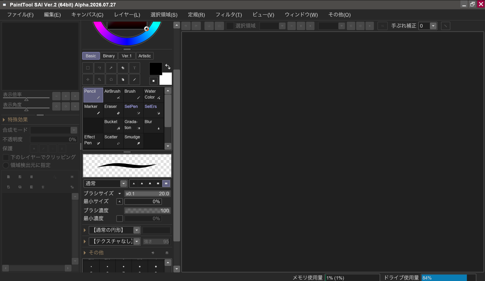
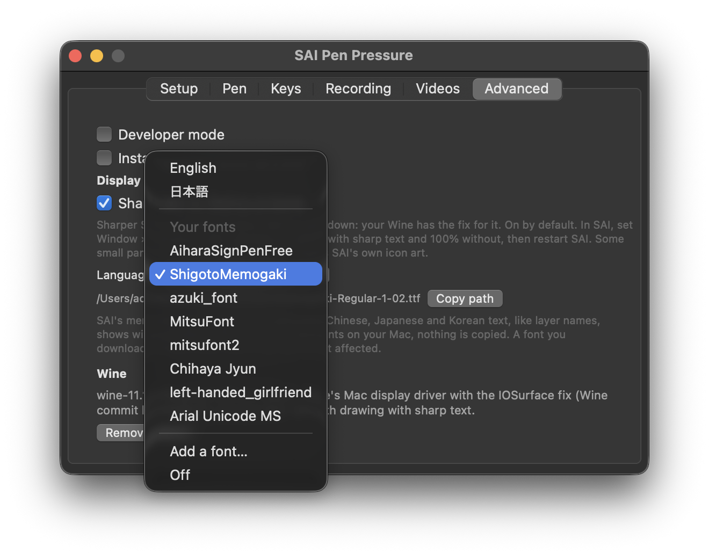
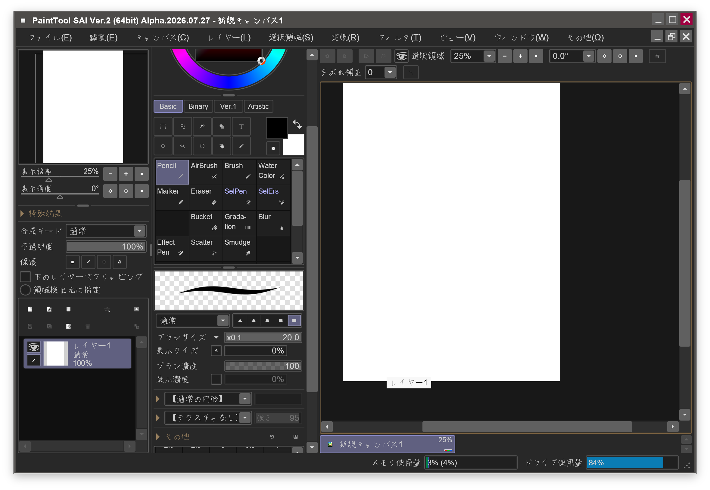
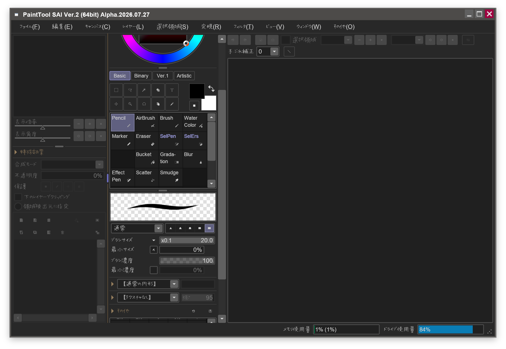
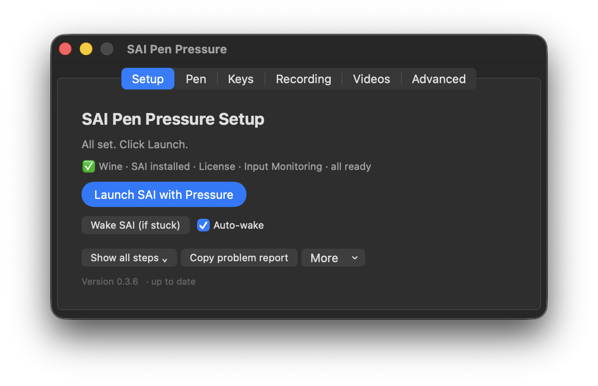

# PaintTool SAI 2 on Mac: pen pressure & timelapse

[](https://github.com/ametrien/Paint-Tool-SAI-pen-pressure-macOS-fix/actions/workflows/build.yml)
[](https://github.com/ametrien/Paint-Tool-SAI-pen-pressure-macOS-fix/releases/latest)
[](https://github.com/ametrien/Paint-Tool-SAI-pen-pressure-macOS-fix/releases)
[](LICENSE)

Run **PaintTool SAI Ver.2** on a Mac with **real pen pressure**, and record a **timelapse of your
canvas** while you draw. Free and open source.

- **[Get started](#get-started):** download, drag to Applications, follow the setup window.
- **[What you get](#what-you-get):** pressure and pen feel, Mac shortcuts, sharp text on Retina screens, Chinese, Japanese and Korean text, timelapse.
- **[What it does not do](#what-it-does-not-do):** SAI and its licence are not included, pressure only, and the limits that belong to SAI or Wine.
- **[Something not working?](#something-not-working):** troubleshooting, and one button that collects a problem report.

📺 **[Watch the setup video](https://youtu.be/62mJwWQsEYI)**

<p align="center">
  
</p>

## What it looks like

Six tabs, one window.

<p align="center">
  <a href="docs/assets/screenshots/all-tabs.png"></a>
</p>
<p align="center"><sub>Full size:
  <a href="docs/assets/screenshots/setup.png">Setup</a> ·
  <a href="docs/assets/screenshots/pen.png">Pen</a> ·
  <a href="docs/assets/screenshots/keys.png">Keys</a> ·
  <a href="docs/assets/screenshots/recording.png">Recording</a> ·
  <a href="docs/assets/screenshots/videos.png">Videos</a> ·
  <a href="docs/assets/screenshots/advanced.png">Advanced</a></sub></p>

### Setup

Where you start SAI, and where installing happens.

- **Launch SAI with Pressure** starts SAI with the bridge in place. **Wake SAI** and **Auto-wake**
  bring SAI back when it stops reacting after you switch apps.
- **Show all steps** lists what SAI needs: Wine, your SAI folder, SAI installed into Wine, the
  pressure bridge, your licence (optional) and the Input Monitoring permission. Each has its own
  fix button, and **Set up everything automatically** does them in order.
- **More** has *Update SAI…* (a newer SAI build, keeping your licence, brushes and preferences),
  *Reset everything & reinstall…* and *Uninstall…*.
- **Copy problem report** puts everything an issue needs on your clipboard.

It does not download SAI or a licence for you: you point it at a SAI folder you already have.

### Pen

How the pen feels in SAI. Pen feel changes apply instantly, without restarting SAI.

- **Pressure levels:** *Auto* uses what your tablet reports; 1024 to 8192 can be set by hand.
  SAI reads this when it starts, so quit and reopen SAI after changing it.
- **Pen feel:** presets named by what you are doing (*Normal*, *Light hand*, *Inking*, *Painting*,
  *Heavy hand*), and up to three profiles of your own, saved, renamed and deleted from the same menu.
- **Pen feel curve**, **Ignore light touch** and **Full width at** fine-tune a preset. The small
  plot shows the result.
- **Test pen** shows two bars: what the app sends, and what actually arrives on SAI's side of the
  bridge. If the first moves and the second stays flat, the app tells you what to press.

It does not change SAI's own brush settings. Pen feel works on top of them, so a brush's
*Min Size* still applies.

### Keys

What each ⌘ and ⌥ key sends to SAI: *Ctrl*, *Alt*, or *Option (types special characters)*, set
separately for the left and right keys. By default ⌘ is Ctrl (⌘Z, ⌘S…) and ⌥ is Alt (the
eyedropper). **Try a key** shows what a key press turns into, without sending anything to SAI.

SAI reads these when it starts, so a change applies the next time SAI opens.

### Recording

The canvas timelapse. Tick **Record a timelapse while I draw**, choose where videos are saved, and
draw. The video is made when SAI closes. **Record every stroke separately** gives more detail, at
the cost of drawing feeling slower.

It records the canvas, not the screen: no panels, no cursor, no zooming, and no sound. Changes
apply the next time SAI starts.

### Videos

One video per drawing, even when you work on it over several evenings. Hover over a still to play
it. **Export…** saves a copy at 30 seconds, 1 or 2 minutes, or full length. **More** renames the
drawing, lists its sessions (to take out one that was filed with the wrong drawing), rebuilds the
video, or deletes it.

It does not edit videos beyond choosing their length.

### Advanced

- **Install updates automatically**, never while SAI is open.
- **Display › Sharp text on Retina screens:** SAI at your screen's full resolution
  ([details](#sharp-text-on-retina-screens-without-lag)).
- **Display › Language:** SAI's menus in English or 日本語, and the font for Chinese, Japanese and
  Korean text, so it shows instead of boxes ([details](#chinese-japanese-and-korean-text)).
- **Wine:** the Wine in use, whether it has the fix for the Retina drawing lag, and buttons to add
  the patch or update Wine.
- **Developer mode** adds the logs, a health check, a diagnostics dump and shortcuts to SAI's
  folders inside Wine.

---

## What you get

**Drawing**

- **Real pen pressure** in SAI, with adjustable levels (up to 8192), pen feel presets and your own profiles
- **Mouse and trackpad still paint normally** — no need to unplug anything
- Works over **Bluetooth as well as USB** (USB samples faster, which shows on quick strokes)
- Works across **multiple monitors**

**It behaves like a Mac app, not Windows in a box**

- **⌘Z / ⌘Y / ⌘S** and the rest, rather than Ctrl — remapped inside Wine, so SAI simply sees the right keys
- **⌥ is Alt** (hold it for the eyedropper). Each key can be changed on the **Keys** tab, for example to keep one ⌥ for typing @ or €
- **Pinch to zoom** and **two-finger scroll to pan** on the trackpad
- **⌃⌥⌘Space** brings back a SAI window that has gone missing, and it can do that automatically when you switch back to SAI
- **Sharp, full-resolution SAI on Retina screens**, without the drawing lag, with a Wine that has the fix (Setup installs one)
- **Chinese, Japanese and Korean text instead of boxes**, with the fonts already on your Mac, and **SAI's menus in Japanese** if you like

**[Canvas timelapse](#credit)** *(v0.2.0+)*

- **A frame each time the pen rests**, or after every stroke if you turn that on — hours of drawing become a couple of minutes
- Records the **canvas, not the screen**: no panels, no cursor, and no camera lurching when you zoom or pan
- Layer opacity and blend modes come through; **several open canvases become one video each**
- Pick a target length; it encodes as you draw, so it costs megabytes rather than gigabytes

**Setup and upkeep**

- **One app, no terminal.** Wine is installed for you, with progress
- Licence handling, including the two-folders trap that silently stops SAI saving
- **Update SAI in place** when a new build lands, keeping your licence, brushes and preferences
- **Updates itself** when you let it, from the GitHub releases, and never while SAI is open
- Reset, reinstall or uninstall from the same window; logs and a health check when something is odd
- **Copy problem report** collects what an issue needs in one paste, with your user name hidden

## Why not just run a virtual machine?

That is what most people do, and it works. It is also heavy for what you get.

| | Virtual machine | This project |
|---|---|---|
| **Cost** | a Windows licence, plus the VM app if it is a paid one | **free, and open source** |
| Disk | tens of gigabytes | ~300 MB for Wine, plus SAI itself |
| Memory | a whole second OS running alongside macOS | a translation layer, only while SAI is open |
| Your tablet | forwarded over virtual USB into the guest | stays on macOS, using the driver you already have |
| Pen pressure | depends on USB passthrough and the guest's driver | read natively on macOS and handed to SAI |
| Starting SAI | boot the VM, wait, then launch SAI | double-click |
| Timelapse | screen-record the window, panels and cursor and all | **built in** — records the canvas itself |

The tablet row is the one that decides it: in a VM your pen has to survive being forwarded through
virtual USB and picked up again by a Windows driver inside the guest, which is exactly where
pressure gets lost or arrives late. Latency you would never notice in a spreadsheet is intolerable
in a brush stroke.

SAI itself is commercial software either way — you need a licence from SYSTEMAX to *save*, whichever
route you take. What this saves you is the Windows licence and the machine around it.

→ **[The longer version](https://ametrien.github.io/Paint-Tool-SAI-pen-pressure-macOS-fix/#why-not-just-run-a-virtual-machine)**, including the honest
trade-off: a VM runs real Windows, so when something misbehaves there it is SAI's fault rather than
the translation layer's.

---

## Get started

1. **[Download the latest release](https://github.com/ametrien/Paint-Tool-SAI-pen-pressure-macOS-fix/releases/latest)** and drag the app to Applications.
2. **Right-click it → Open** the first time (macOS asks once, because the app is not notarised).
3. Follow the setup window. It installs Wine, finds your SAI folder, and checks the one permission it needs.

You bring your own copy of **PaintTool SAI Ver.2** and, if you want to save your work, a licence
from SYSTEMAX. Everything else the app handles.

### Sharp text on Retina screens, without lag

1. **Check that your Wine has the fix** in **Advanced › Wine**. A new install gets one. If yours is older,
   press **Update Wine for sharper, faster drawing** (quit SAI first), or **Add patch** if you have Wine Staging 11.16.
   Wine **11.22 or newer** has the fix built in, once it is released.
2. **Advanced › Display › Sharp text on Retina screens.** With the fix in place it is on by default.
3. **In SAI, set Window › Scaling of User Interface to 200%**, then quit and reopen SAI so its panels land
   where they should. If you turn sharp text off again, set it back to 100% and restart SAI once more.

Some small panel icons stay small at 200%. That is SAI's own icon art
([#45](https://github.com/ametrien/Paint-Tool-SAI-pen-pressure-macOS-fix/issues/45)).
Why the fix is needed: [issue #39](https://github.com/ametrien/Paint-Tool-SAI-pen-pressure-macOS-fix/issues/39) and
[RETINA-LAG-FINDINGS.md](RETINA-LAG-FINDINGS.md).

### Chinese, Japanese and Korean text

SAI asks for Windows fonts that a Mac does not have, so without help these characters show as boxes.
**Advanced › Display › Language** fixes that with the fonts that come with your Mac:

- **English** or **日本語** for SAI's menus. SAI's menus only come in these two languages.
- **Chinese, Japanese and Korean text**, such as layer names, file names and dialogs, shows with either:
  the app uses Hiragino Sans, PingFang and Apple SD Gothic Neo, in the order of your Mac's languages.
- **Your own fonts** installed with Font Book are in the list too. *Add a font…* takes one you downloaded:
  it opens in Font Book to install. The path of the font in use is shown, with *Copy path*.

The app never copies, bundles or downloads a font; it only points Wine at the fonts on your Mac.
SAI's Text tool is not affected: it uses its own font engine, which does not support these fonts yet.
A change takes effect the next time SAI starts.

<p align="center"><a href="docs/assets/screenshots/sai-japanese.png"></a></p>

#### Your own fonts

Fonts you installed with Font Book show up under **Your fonts** in the same menu. SAI's menus and
panels then use that font for Chinese, Japanese and Korean, and the path is shown with *Copy path*.
Use fonts whose licence lets you use them; the app never copies them.

<p align="center"><a href="docs/assets/screenshots/font-menu.png"></a></p>

<p align="center">
  <a href="docs/assets/screenshots/sai-font-mitsu.png"></a>
  <a href="docs/assets/screenshots/sai-font-shigoto.png"></a><br>
  <sub>MitsuFont (left) and ShigotoMemogaki (right)</sub>
</p>

→ **[Full install guide](https://ametrien.github.io/Paint-Tool-SAI-pen-pressure-macOS-fix/install)**, including the manual command-line route
→ **[Troubleshooting](https://ametrien.github.io/Paint-Tool-SAI-pen-pressure-macOS-fix/troubleshooting)**, organised by how to tell which problem you have
→ **[How it works](https://ametrien.github.io/Paint-Tool-SAI-pen-pressure-macOS-fix/how-it-works)**, if you want the architecture

---

## Canvas timelapse

> **Requires v0.2.0 or later. macOS only** — on Windows or Linux use
> [art-timelapse](https://github.com/cromachina/art-timelapse), which is where this idea came
> from. See [credit](#credit).

<p align="center">
  
  <br>
  <em>Fifteen strokes, recorded and played back — the canvas alone, with nothing else in frame.</em>
  <br>
  <a href="docs/assets/demo/timelapse-example.mp4">Watch the original video</a>
</p>

Recording is on by default. Draw; when you close SAI, the video is made and filed under the
drawing's name in the **Videos** tab, in `~/Movies/SAI Timelapses`. Come back to the same drawing
another day and it is added to the same video. **Make video now…** in the Recording tab makes one
mid-session; recording carries on afterwards.

It reads SAI's canvas out of memory rather than capturing the screen, so the video is the artwork
alone: no panels, no cursor, and no camera movement when you zoom, pan or rotate while working.
Layer opacity and blend modes come through, and several open canvases each get their own video.

→ **[More about recording](https://ametrien.github.io/Paint-Tool-SAI-pen-pressure-macOS-fix/#canvas-timelapse)** — video length, what happens to undo, and
how much disk it uses

---

## What it does not do

**Not included, by design**

- **SAI and its licence.** Bring your own. This project cannot supply, generate or activate a
  licence, and never will.
- **Changes to SAI itself.** Nothing patches `sai2.exe`. The bridge is a `wintab32.dll` that SAI
  loads through its own WinTab support, plus a helper that runs on macOS.
- **Accounts, analytics, telemetry.** The app's only network use is GitHub: checking for new
  versions of itself and of Wine, and downloading them. *Copy problem report* goes to your
  clipboard, with your user name hidden by default.
- **Windows or Linux.** For the timelapse there, use
  [art-timelapse](https://github.com/cromachina/art-timelapse) (see [credit](#credit)).
- **Notarisation.** Releases are ad-hoc signed and not notarised (that needs a paid Apple
  Developer membership). Hence the one-time right-click → Open, and Input Monitoring has to be
  granted again after each update.

**Limits of the bridge**

- **Pressure only.** Tilt, rotation and the eraser end are not forwarded; the test tablet has
  none of them.
- **One tablet tested** (Wacom Intuos CTL-4100). Any tablet macOS itself recognises should work,
  because the helper reads standard tablet events, but Huion, XP-Pen and others are untested.
- **Bluetooth report rate (~130 Hz)** makes fast curves boxy; USB gives ~200 Hz
  ([why](https://ametrien.github.io/Paint-Tool-SAI-pen-pressure-macOS-fix/troubleshooting#fast-curves-come-out-boxy)).
- **A screen connected while SAI is open** may need SAI restarted before it gets pressure. Until
  then the pen works there as a mouse, and the menu-bar icon says so
  ([#37](https://github.com/ametrien/Paint-Tool-SAI-pen-pressure-macOS-fix/issues/37)).

**Limits that belong to SAI or Wine**, worked around where possible

- **SAI can freeze on input after switching apps** (Wine's macOS driver). The app wakes it when
  you come back; if it still sticks, press **⌃⌥⌘Space** or use the pen icon in the menu bar →
  *Wake SAI*.
- **The pen cannot click SAI's top menu row** (File, Edit, …): SAI drops the click once it knows a
  pen is present. Use the trackpad or mouse for the menu
  ([#1](https://github.com/ametrien/Paint-Tool-SAI-pen-pressure-macOS-fix/issues/1)).
- **Some small panel icons stay tiny at 200% scaling.** They are fixed-size bitmaps inside SAI;
  only SYSTEMAX can change them
  ([#45](https://github.com/ametrien/Paint-Tool-SAI-pen-pressure-macOS-fix/issues/45)).
- **Wine is an Intel build.** Gcenx's Wine Staging runs under Rosetta on Apple Silicon, and Apple
  ends Rosetta for apps with **macOS 28** (expected autumn 2027). The app itself is native and not
  affected; Wine has to move to an Apple Silicon build that runs SAI's x86 code through the FEX
  emulator. Those exist in preview; the plan is in
  [KNOWN_ISSUES](KNOWN_ISSUES.md#4-wine-runs-under-rosetta-and-rosetta-ends-with-macos-28)
  ([#30](https://github.com/ametrien/Paint-Tool-SAI-pen-pressure-macOS-fix/issues/30)).

**[KNOWN_ISSUES.md](KNOWN_ISSUES.md)** has the full explanation of each, what was tried, and
what did not work.

## Tested on

As of 0.3.11:

- Mac: **Apple M3 Pro**, **macOS Tahoe 26.6.2 (25G83)**
- Wine: **Wine Staging 11.16 (Gcenx) with the Retina patch**, the build Setup installs
- SAI: **PaintTool SAI Ver.2 (64-bit)**
- Tablet: **Wacom Intuos BT S (CTL-4100WL)**, over USB and Bluetooth
- Displays: one screen, two screens mirrored, and two screens extended, including a screen
  connected while SAI is open

Users have also reported it working on an M5 MacBook Air with a USB Intuos S, and with an external
LG UltraFine display. Other tablets, Macs and display setups are untested; reports are welcome as
issues (see [CONTRIBUTING](CONTRIBUTING.md)).

## How it works, in short

Wine already runs SAI on a Mac and moves the cursor, but its Mac driver throws pen **pressure**
away. This project adds it back with a two-part bridge:

- a **custom `wintab32.dll`** that speaks the WinTab tablet API to SAI, loaded by Wine in place of
  its own (no Wine rebuild), and
- a small **native macOS helper** that reads your tablet's real pressure and sends it to that DLL.

→ **[How it works](https://ametrien.github.io/Paint-Tool-SAI-pen-pressure-macOS-fix/how-it-works)**, the full architecture

---

## Something not working?

First: **[Troubleshooting](https://ametrien.github.io/Paint-Tool-SAI-pen-pressure-macOS-fix/troubleshooting)**,
organised by how to tell which problem you have. If pressure is the problem, the **Pen** tab's
**Test pen** shows two bars: what the app sends, and what actually arrives on the other side,
inside Wine, where SAI would read it. If the top one moves and the bottom stays flat, the app
will tell you what to press.

If that doesn't sort it, **[open an issue](https://github.com/ametrien/Paint-Tool-SAI-pen-pressure-macOS-fix/issues/new/choose)**
and start it with **Copy problem report** on the Setup tab:

<p align="center">
  
</p>

That one button collects everything needed to help: your Mac and chip, macOS and Wine versions,
your tablet and how it is connected, whether Wine is loading the pressure bridge or ignoring it,
what SAI last received, and the recent log. Paste it into the issue and there is usually nothing
else to gather.

**Please write issues in English.** A machine translation (DeepL, Google Translate, ChatGPT) is
completely fine — I just can't read Chinese, Japanese, Korean and so on, and I'd rather not guess at
what you meant. You're welcome to paste your original text underneath the translation.

请用英文提交 issue（机器翻译即可）· Issue は英語でお願いします（機械翻訳で大丈夫です）

---

## Build from source (contributors)

`make-app.sh` builds everything into `dist/`: the helper and the timelapse encoder as universal
binaries, from the file lists in `wacom-helper/sources.txt` and `timelapse-encoder/sources.txt`,
and the app bundle around them. Only `wintab32.dll` and the test probe `wtprobe.exe` are committed
prebuilt, because cross-compiling them needs mingw-w64. By hand:
```bash
# wintab32.dll and the test probe  (brew install mingw-w64)
cd wintab-src
x86_64-w64-mingw32-windres wintab32.rc -O coff -o wintab32_res.o
x86_64-w64-mingw32-gcc -shared -O2 -o wintab32.dll wintab32.c wintab32_res.o wintab32.def \
    -lgdi32 -luser32 -lws2_32 -municode
x86_64-w64-mingw32-gcc -O2 -Wall -Wextra -o wtprobe.exe wtprobe.c -luser32

# native helper  (Xcode command-line tools)
cd ../wacom-helper
swiftc -O -o wacom-pressure-helper $(bash ../tools/sources.sh helper)
```

Tests: `bash tests/run-tests.sh` runs the C cores under AddressSanitizer and UBSanitizer, the
Swift cores, and the end-to-end checks on a real filesystem. CI runs the same script on every push.

Contributions welcome — especially testing on other tablets and Macs.

---

## How it fits together

<p align="center">
  
</p>

**The pen.** The tablet moves the cursor in every app, but the pressure stops at macOS. The app
reads it through an event tap, applies your pen feel, and sends each sample over UDP
(`127.0.0.1:47800`) to our `wintab32.dll`. Wine loads that DLL into `sai2.exe` in place of its
own, so SAI asks it for pen packets the ordinary Windows way. If the port is busy, the DLL reads
the newest sample from `C:\wt_pressure.txt` instead.

**Where things live.**

| What | Where |
|---|---|
| The app | `/Applications/SAI Pen Pressure.app` |
| Wine | `/Applications/Wine Staging.app` (installed by the app if missing) |
| SAI's own Windows drive (the Wine prefix) | `~/SAI2-pressure` |
| SAI itself | `~/SAI2-pressure/drive_c/SAI2/` |
| Your licence | the original `.slc` file from SYSTEMAX, copied to `~/SAI2-pressure/drive_c/SAI2/` **and** `~/SAI2-pressure/drive_c/SAI2/settings/`, because older and newer SAI builds read it from different folders |
| A spare copy of the licence | `~/Library/Application Support/SAIPenPressure/license/`, so a rebuilt prefix gets it back |
| Our DLL | `~/SAI2-pressure/drive_c/windows/system32/wintab32.dll`, replaced from the app on every launch when they differ |
| App settings | `~/Library/Application Support/SAIPenPressure/` |
| Timelapse videos | `~/Movies/SAI Timelapses/`, one folder per drawing |

The SAI folder you pick during setup is only a source: SAI is copied into the prefix and runs
from there.

**Small files in `C:\`.** The two halves agree through a few text files in
`~/SAI2-pressure/drive_c`: the pressure scale (`wt_pmax.txt`, written before SAI starts), the
Wake SAI request (`wt_wake.txt`), pinch-to-zoom steps (`wt_zoom.txt`), and the DLL's own report
(`wt_status.txt`), which is how the app knows the bridge really is loaded inside SAI.

**The timelapse.** Because the DLL runs inside SAI, it can read the canvas straight from SAI's
memory after a stroke and write it to `drive_c/sai-timelapse/frames/`. A separate encoder process
turns those frames into H.264 video, so video work never slows the pen, and the Videos tab groups
sessions of the same drawing into one video.

The full story, with the reasons behind each choice, is in
[How it works](https://ametrien.github.io/Paint-Tool-SAI-pen-pressure-macOS-fix/how-it-works).

---

## Credit

**The canvas timelapse is our own implementation, inspired by
[art-timelapse](https://github.com/cromachina/art-timelapse).** How we built it, step by step:
[TIMELAPSE-PLAN.md](TIMELAPSE-PLAN.md).

The timelapse exists because of [**cromachina/art-timelapse**](https://github.com/cromachina/art-timelapse),
which has been doing this on Windows and Linux for a while. The insight — that SAI's canvas can be
read out of the running process, so a timelapse can show the artwork rather than a recording of the
application — is theirs, and so is the knowledge of roughly where to look inside a canvas structure.

**On Windows or Linux, go and use it.** It is the right tool there, and this project has nothing to
offer those platforms.

The implementations differ substantially. art-timelapse reads SAI from *outside* the process, which
on macOS would need a debugger entitlement and a permission prompt; this reads it from *inside*,
because a tablet bridge already runs in there for pressure — which also means a finished brush
stroke is something we are told rather than something inferred from mouse events. No code was
copied. The memory offsets are facts about SAI's binary and were verified here against a live
process, though the field layout was informed by theirs rather than found blind; the full account is
in [TIMELAPSE-PLAN.md](TIMELAPSE-PLAN.md).

art-timelapse is GPL-3.0 and this project is MIT, which is why the boundary was worth keeping clear.

## License & attribution

This project (the pressure-bridge code — `wintab32.dll` source, the macOS helper, the
installer and documentation) is released under the **[MIT License](LICENSE)**.

**PaintTool SAI** is proprietary software by SYSTEMAX Software Development (Koji Komatsu).
This project does **not** include — and must never include — SAI itself, its installer, or
any license certificate. You obtain those from <https://www.systemax.jp/en/sai/> yourself.
The MIT license here covers only the bridge code in this repository.
